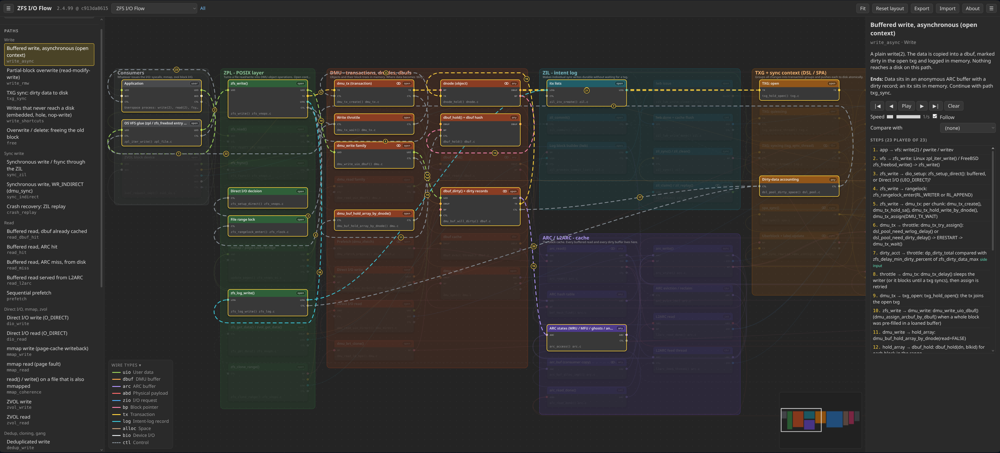

# ZFS Data Flow Visualizer

This visualizer was created utilizing Fable 5.2. As a visual thinker, I wanted something to help me wrap my head around some of the stages of zfs internal mechanisms.

***There may and probably are mistakes, do not trust this as 100% accurate.***

To view the visualizer, clone the repo, then open ./viewer/index.html in your browser; everything is self contained in this repo.

